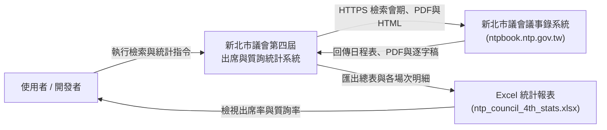
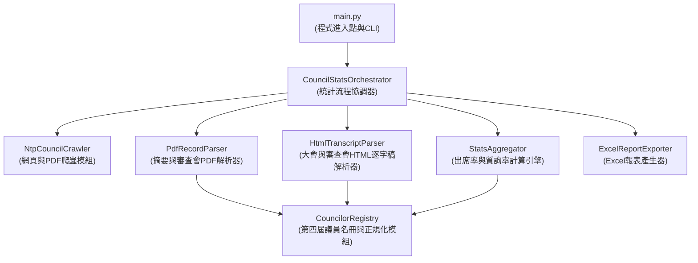
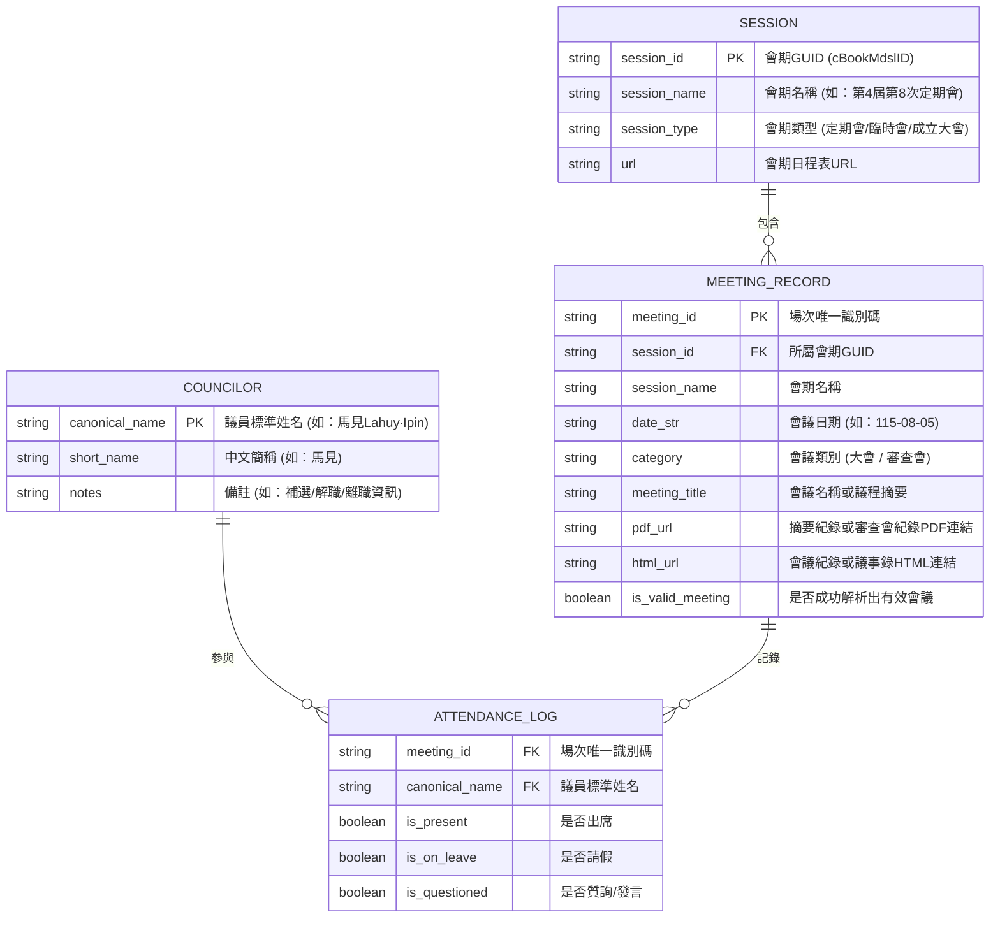
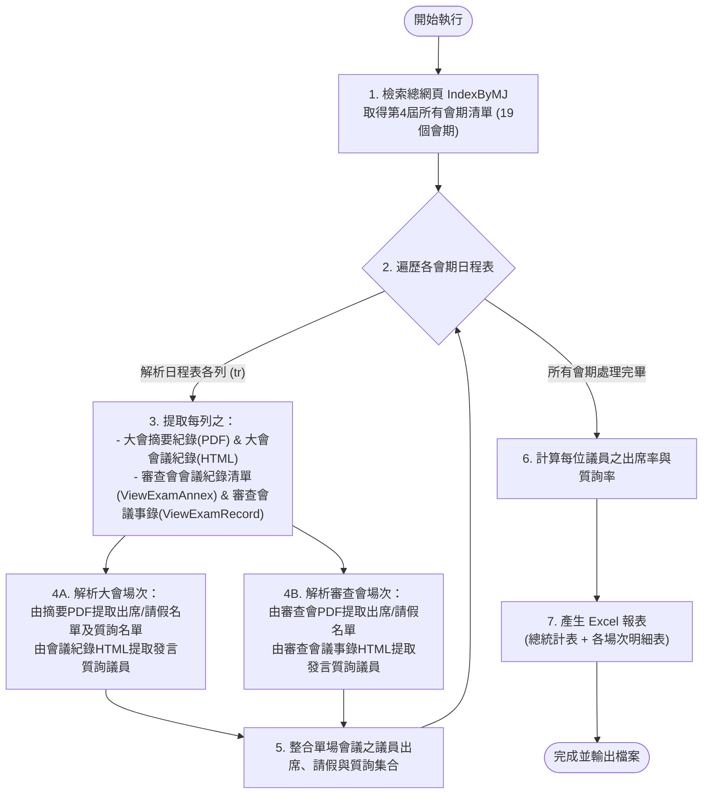
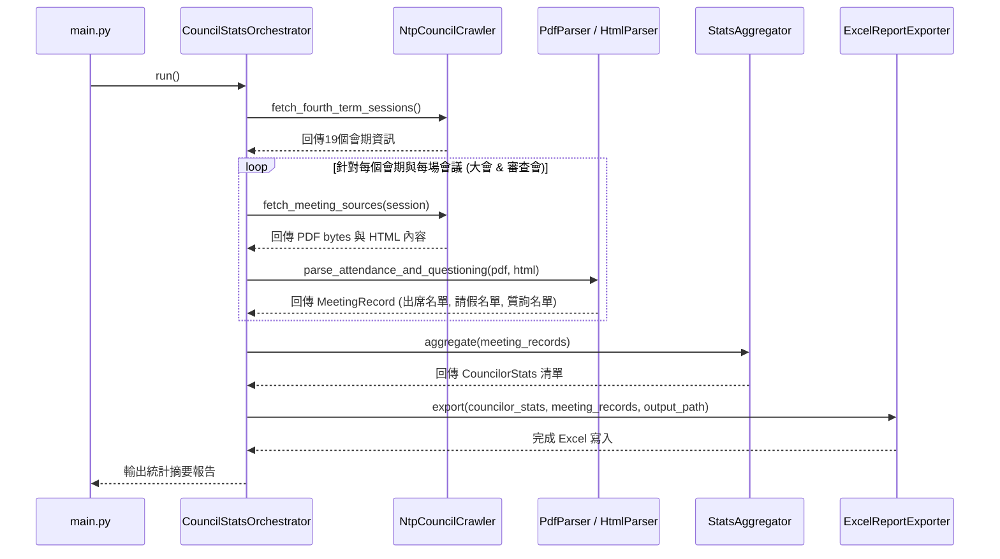
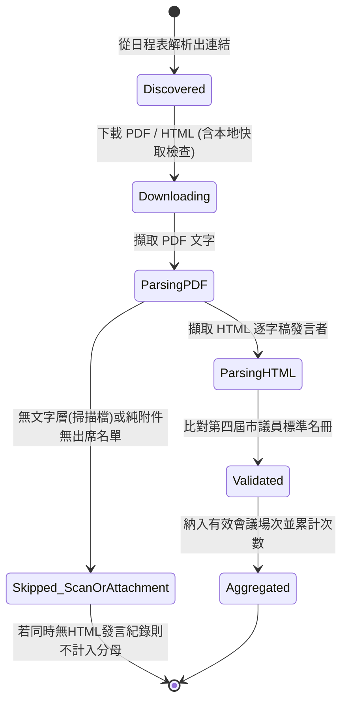
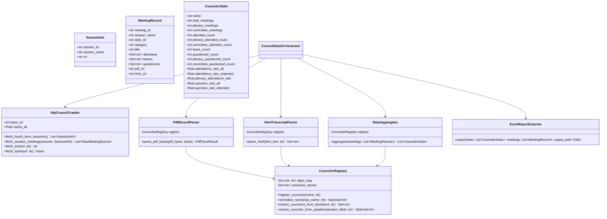

# 新北市議會第四屆議員出席與質詢統計系統 - 系統規格書 (spec.md)

## 1. 系統概述
本系統自動檢索新北市議會議事錄系統（`https://ntpbook.ntp.gov.tw/Home/Home/IndexByMJ`）中**第四屆所有會期**（定期會、臨時會、成立大會）之日程表，針對各日程中的**大會**與**審查會（委員會）**，下載並解析「摘要紀錄 / 審查會會議紀錄（PDF）」與「會議紀錄 / 審查會議事錄（HTML逐字稿）」，提取**市議員**之出席、請假與質詢紀錄，最終產出包含「議員統計總表」與「會議場次明細表」之 Excel 檔案。

---

## 2. 架構與選型

### 2.1 技術選型
- **開發語言**：Python 3.10+
- **網路請求與快取**：`urllib.request` / `requests`（搭配自訂 SSL Context 以相容目標網站憑證，並具備本地檔案快取與多執行緒並行下載機制，提升執行效率並避免重複請求）
- **HTML 解析**：`BeautifulSoup4` (`bs4`) + `正则表达式 (re)`
- **PDF 文字擷取**：`pypdf`（針對文字型 PDF 直接提取）
- **資料處理與 Excel 匯出**：`pandas` + `openpyxl`（支援自動欄寬調整、百分比格式化與凍格設定）
- **單元測試**：Python 內建 `unittest` / `pytest`

### 2.2 系統脈絡圖 (System Context Diagram)


### 2.3 模組關係圖 (Module Relationship Diagram)


---

## 3. 資料模型與 ER 圖

### 3.1 資料模型 (Entity-Relationship Diagram)


### 3.2 議員名單辨識與正規化規則
1. **僅記錄市議員**：
   - 系統從各次定期會之「席次表」及所有會議之「出席」、「請假」區塊建立**第四屆全體市議員標準名冊**（包含原住民議員全名如 `馬見Lahuy‧Ipin`、`蘇錦雄Paylang‧Caya`、`宋雨蓁Nikar‧Falong`，以及第四屆曾任職之所有議員）。
   - 嚴格排除「列席」之市政府官員（如市長、副市長、局長、處長、主委）與議會行政人員（秘書長、副秘書長、主任、專門委員、朗讀人員）。
2. **姓名正規化**：
   - 原住民議員在 PDF 與 HTML 中可能出現全形點（`．`、`‧`、`・`）或空格差異，統一正規化為標準名稱（例如將 `馬見 Lahuy．Ipin`、`馬見Lahuy‧Ipin` 統一對應至同一位議員）。
   - 會議紀錄中的稱謂（如 `陳議員偉杰`、`宋雨蓁Nikar．Falong議員`、`蔣議長根煌`、`陳副議長鴻源`、`邱烽堯召集人`）皆會還原為議員本人標準姓名。

---

## 4. 關鍵流程與統計邏輯

### 4.1 系統流程圖 (Flowchart)


### 4.2 序列圖 (Sequence Diagram)


### 4.3 狀態圖 (State Diagram - 單場會議紀錄生命周期)


### 4.4 出席率與質詢率計算定義
1. **有效會議場次認定**：
   - **大會場次**：日程表中每一列若有「大會摘要紀錄 PDF」或「大會會議紀錄 HTML」，視為一場大會會議。
   - **審查會場次**：日程表中同一日期可能有多個審查會（如第1審查會、第2審查會...）。系統會將該日 `ViewExamAnnex` 下載的各審查會會議紀錄 PDF（如「1150814第5審查會會議紀錄」）與 `ViewExamRecord` 的各審查會議事錄 HTML（如「第5審查委員會」）**依審查會編號（第1~6審查會、法規會、紀律會等）配對合併為獨立的審查會場次**。若某附件 PDF 僅為純表格附件（無出席名單且非會議紀錄），則自動過濾不計入會議場次。
2. **出席率計算公式**：
   - **應出席場次數**：
     - 我們同時提供兩種指標供檢視：
       1. **全會期總場次出席率**：$\text{出席率} = \frac{\text{該議員實際出席場次數}}{\text{系統檢索之有效會議總場次數}}$
       2. **有紀錄場次出席率（出席 / (出席+請假)）**：由於審查會（委員會）僅該委員會所屬委員需出席，非該委員會議員不會出現在該審查會的出席或請假名單中；因此同時計算 $\text{應到場次出席率} = \frac{\text{實際出席場次數}}{\text{實際出席場次數} + \text{請假場次數}}$，讓大會與審查會的出席表現皆能精準呈現。
       3. 此外，在總統計表中亦會**分別列出「大會出席次數/大會出席率」與「審查會出席次數」及「合併總出席次數/總出席率」**，一目了然。
3. **質詢（發言）名單與質詢率計算公式**：
   - **質詢人員判定**：
     - 只要該名市議員在該場會議的「會議紀錄 / 議事錄（HTML逐字稿）」中有發言紀錄（例如 `○○議員：`），**或**在「摘要紀錄（PDF）」的質詢段落中（例如 `有○○議員、○○議員等提出多項問題` 或 `○○議員要求：`）被列為質詢議員，即判定該場次該議員**有質詢**（同一場會議多次發言計為 1 場次質詢，並另外統計總發言段落次數供參考）。
     - 註：擔任會議「主席：」主持議事之程序性宣告，不計入質詢；但若以議員身分列於發言欄位（如 `石議員一佑：`）則計入質詢。
   - **質詢率計算公式**：
     - **全場次質詢率（依使用者確認之定義）**：$\text{全場次質詢率} = \frac{\text{該議員有質詢之會議場次數}}{\text{所有有開會之有效會議總場次數}}$
     - **出席場次質詢率（輔助參考指標）**：$\text{出席場次質詢率} = \frac{\text{該議員有質詢之會議場次數}}{\text{該議員實際出席之會議場次數}}$

### 4.5 實際資料特殊情況處理（實測後補充）
1. **出席欄為「詳如簽到簿」**：部分場次（如市政總質詢）摘要紀錄未列出席名單。此類場次：
   - 標記為「出席名單未列（詳如簽到簿）」，**不納入出席率分母**（無法得知誰出席，不作推定）。
   - 仍納入質詢率分母，請假名單照常計入請假次數。
   - 明細表中出席欄位顯示「詳如簽到簿」。
2. **任期中異動（離職或補選）**：以議員在所有紀錄（出席、請假、質詢）中**首次與最後出現的日期**推定其在任期間，另外提供「任期內」指標：
   - 任期內出席率 = 實際出席總場次 ÷ 任期內有出席名單之會議場次。
   - 任期內質詢率 = 總質詢場次數 ÷ 任期內會議總場次。
3. **掃描影像 PDF（無文字層）**：無法擷取文字者，若該場次另有 HTML 逐字稿，仍以逐字稿取得質詢名單；兩者皆無則不計入。
4. **議員名冊動態建立**：以第 4 屆席次表的 64 位議員作為種子名冊，再從所有「出席／請假」欄位中出現 2 次以上的姓名自動補入（涵蓋已離職或補選議員）；名字黏在一起的字串（如 `山田摩衣林裔綺`）以名冊進行最長比對切分。
5. **逐字稿發言者判定**：只把標示為 `○議員○○：`、`○委員○○：`、`○召集人○○：` 且可對應到名冊的發言者算作質詢；`主席：`、議長、副議長主持議事的發言，以及官員、行政人員發言均不計入。
6. **SSL 憑證**：目標網站憑證缺少 Subject Key Identifier，Python 3.13 以後的嚴格檢查會拒絕。系統只關閉 `VERIFY_X509_STRICT` 嚴格旗標，**仍保留憑證鏈與主機名稱驗證**。

---

## 5. 類別圖 (Class Diagram)


---

## 6. 虛擬碼 (Pseudocode)

```text
FUNCTION RunCouncilStatistics():
    初始化 CouncilorRegistry (載入新北市第4屆市議員標準名冊與原住民議員別名映射)
    初始化 NtpCouncilCrawler (啟用本地快取目錄 .cache/)
    
    sessions = Crawler.FetchFourthTermSessions("https://ntpbook.ntp.gov.tw/Home/Home/IndexByMJ")
    all_meetings = []

    FOR EACH session IN sessions:
        agenda_rows = Crawler.ParseSessionTable(session.url)
        FOR EACH row IN agenda_rows:
            # 1. 處理大會場次
            IF row 有 大會摘要紀錄PDF OR row 有 大會會議紀錄HTML:
                attendees, leaves, pdf_questioners = 解析大會摘要PDF(row.summary_pdf_url)
                html_questioners = 解析大會會議紀錄HTML(row.record_html_url)
                questioners = pdf_questioners UNION html_questioners
                # 若議員在該場次有質詢但摘要PDF未列出(例如僅有HTML無PDF之場次)，可依規則標註
                IF attendees OR leaves OR questioners 非空:
                    建立 MeetingRecord(category="大會", attendees, leaves, questioners)
                    加入 all_meetings

            # 2. 處理審查會場次
            IF row 有 審查會會議紀錄(ViewExamAnnex) OR row 有 審查會議事錄(ViewExamRecord):
                committee_map = 依審查會名稱配對該日之 PDF 與 HTML
                FOR EACH (comm_name, comm_sources) IN committee_map:
                    attendees, leaves, pdf_q = 解析審查會PDF(comm_sources.pdf_url)
                    html_q = 解析審查會議事錄HTML(comm_sources.html_url)
                    questioners = pdf_q UNION html_q
                    IF attendees OR leaves OR questioners 非空:
                        建立 MeetingRecord(category="審查會", title=comm_name, attendees, leaves, questioners)
                        加入 all_meetings

    # 3. 統計計算
    stats_list = StatsAggregator.Aggregate(all_meetings, CouncilorRegistry.GetAllCouncilors())

    # 4. 匯出 Excel
    ExcelReportExporter.Export(
        stats_list,
        all_meetings,
        output_path="新北市議會第4屆議員出席與質詢統計表.xlsx"
    )
END FUNCTION
```

---

## 7. Excel 報表欄位規格

輸出的 Excel 檔案（`新北市議會第4屆議員出席與質詢統計表.xlsx`）包含三個工作表（Sheets）：

### 工作表 1：`議員出席與質詢總統計表`
| 欄位名稱 | 說明 |
| :--- | :--- |
| **議員姓名** | 第四屆市議員標準姓名 |
| **總會議場次數 (大會+審查會)** | 第四屆所有有效開會場次總數（分母） |
| **實際出席總場次** | 大會出席場次 + 審查會出席場次 |
| **請假總場次** | 大會請假場次 + 審查會請假場次 |
| **總出席率 (占全體會議場次)** | `實際出席總場次 / 總會議場次數`（百分比格式） |
| **應到場次出席率 (出席/(出席+請假))** | `實際出席總場次 / (實際出席總場次 + 請假總場次)`（排除非所屬審查會之影響） |
| **總質詢場次數** | 大會或審查會有質詢/發言之場次總數（分子） |
| **總質詢率 (占全體會議場次)** | `總質詢場次數 / 總會議場次數`（依確認之定義計算） |
| **出席場次質詢率 (質詢/實際出席)** | `總質詢場次數 / 實際出席總場次`（輔助指標） |
| **大會總場次** | 大會有效場次總數 |
| **大會出席場次** | 該議員於大會出席之場次數 |
| **大會請假場次** | 該議員於大會請假之場次數 |
| **大會出席率** | `大會出席場次 / 大會總場次` |
| **大會質詢場次** | 該議員於大會質詢之場次數 |
| **大會質詢率** | `大會質詢場次 / 大會總場次` |
| **審查會出席場次** | 該議員於各審查會出席之場次數 |
| **審查會請假場次** | 該議員於各審查會請假之場次數 |
| **審查會質詢場次** | 該議員於各審查會發言/質詢之場次數 |
| **有出席名單之會議場次** | 出席率分母（排除「詳如簽到簿」場次） |
| **首次出現日期 / 最後出現日期** | 推定在任期間 |
| **任期內會議場次 / 任期內出席率 / 任期內質詢率** | 依推定在任期間計算之輔助指標 |
| **總發言段落數** | 逐字稿中該議員發言的段落總數（參考用） |

### 工作表 3：`統計說明`
列出資料來源、檢索時間、各指標計算公式、特殊情況處理方式與檢索統計（會期數、場次數、掃描檔數等）。

### 工作表 2：`各場次會議明細表`
| 欄位名稱 | 說明 |
| :--- | :--- |
| **場次編號** | 流水號 |
| **會期名稱** | 如：`第4屆第8次定期會` |
| **會議日期** | 如：`115-08-05` |
| **會議類別** | `大會` 或 `審查會` |
| **議次 / 委員會名稱** | 如：`第1次會議`、`預備會議`、`第5審查委員會` |
| **議程摘要** | 該場次之上午/下午議程內容或PDF標題 |
| **出席議員人數** | 該場次出席市議員總人數 |
| **出席議員名單** | 以頓號（`、`）分隔之出席市議員名單 |
| **請假議員人數** | 該場次請假市議員總人數 |
| **請假議員名單** | 以頓號（`、`）分隔之請假市議員名單 |
| **質詢議員人數** | 該場次質詢/發言市議員總人數 |
| **質詢議員名單** | 以頓號（`、`）分隔之質詢/發言市議員名單 |
| **摘要/紀錄PDF連結** | 原始 PDF 檔案網址 |
| **會議紀錄/議事錄連結** | 原始 HTML 逐字稿網址 |
